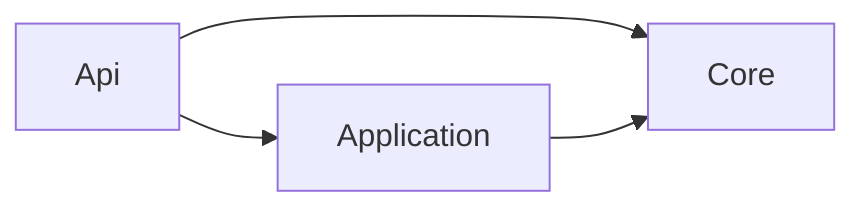

# API Code Style

## Contents
- [1. Architecture and Components](#1-architecture-and-components)
  - [1.1. Layer Dependencies](#11-layer-dependencies)
  - [1.2. Controller](#12-controller)
  - [1.3. Handler](#13-handler)
  - [1.4. Command](#14-command)
  - [1.5. Query](#15-query)
- [2. Project Structure and Code Organization](#2-project-structure-and-code-organization)
  - [2.1. Feature Structure](#21-feature-structure)
  - [2.2. File and Folder Naming](#22-file-and-folder-naming)
  - [2.3. Test Location](#23-test-location)
- [3. Code Style Standards](#3-code-style-standards)
  - [3.1. Method Naming](#31-method-naming)
  - [3.2. Async Methods](#32-async-methods)
  - [3.3. Request / Response Naming](#33-request--response-naming)
  - [3.4. DTO Naming for Request and Response Models](#34-dto-naming-for-request-and-response-models)
  - [3.5. List Naming](#35-list-naming)
  - [3.6. Parameter Naming in Lambda Expressions](#36-parameter-naming-in-lambda-expressions)
  - [3.7. Null-Forgiving Operator (!)](#37-null-forgiving-operator-)
  - [3.8. Adding unauthorized karate tests](#38-adding-unauthorized-karate-tests)
  - [3.9. AsNoTracking in Queries](#39-asnotracking-in-queries)
  - [3.10. Separate DTOs for Requests and Responses](#310-separate-dtos-for-requests-and-responses)

# 1. Architecture and Components

Our entire architecture is built so that its components can be easily tested in isolation.

## 1.1. Layer Dependencies

Now we agreed to use 3 layers:

1. **Api**

- This is a thin layer. It receives the request, runs all the decorators (middlewares), for example, checks whether the account has permissions, and delegates the processing of the request to the next layer (Application).

2. **Application**

- This layer implements all the use cases, works with the database, turns entities into response models, and makes requests to neighbouring services. This is where the main work happens.

3. **Core**
- This layer contains domain entities and performs business calculations.

Dependencies point from the outer layers to the inner ones.

- The `Core` layer does not depend on anything.
- The `Application` layer may depend only on `Core`.
- The `Api` layer may depend on `Application` and/or `Core`, but not the other way around.



## 1.2. Controller

- A controller must always call only a `Handler` and nothing more. All business logic and data access are delegated to `Handler`.

**✅ Good**
```c#
[HttpPost]
public Task<CreateToDoResponse> CreateToDoAsync(
  [Required] [FromBody] CreateToDoRequest createToDoRequest,
  [FromServices] CreateToDoHandler createToDoHandler
)
{
  // ✅ Controller calls handler
  return createToDoHandler.HandleAsync(createToDoRequest);
}
```

**❌ Bad**
```c#
[HttpPost]
public Task<CreateToDoResponse> CreateToDoAsync(
  [Required] [FromBody] CreateToDoRequest createToDoRequest,
  [FromServices] CreateToDoCommand createToDoCommand
)
{
  // ❌ Controller operates on the handler's logic directly
  var newToDo = new ToDo
  {
    Name = createToDoRequest.Name,
    CreatedAtUtc = dateTimeProvider.UtcNow,
  };

  await context.ToDos.AddAsync(newToDo);

  await context.SaveChangesAsync();

  return newToDo.Id;
}
```

**Rationale:** TODO?

## 1.3. Handler

- A `Handler` may call only a `Command` or a `Query`.
- Only a `Handler` may build a response.

**✅ Good**
```c#
public class CreateToDoHandler(
  CreateToDoCommand createToDoCommand
)
{
  public async Task<CreateToDoResponse> HandleAsync(CreateToDoRequest createToDoRequest)
  {
    // ✅ Handler calls a command
    var id = await createToDoCommand.ExecuteAsync(createToDoRequest);

    return new CreateToDoResponse
    {
      Id = id,
    };
  }
}
```

**✅ Good**
```c#
public class GetToDosHandler(
  GetToDosQuery getToDosQuery,
  IDateTimeProvider dateTimeProvider
)
{
  public async Task<GetToDosResponse> HandleAsync()
  {
    // ✅ Handler calls a query
    var toDos = await getToDosQuery.GetAsync();

    return new GetToDosResponse
    {
      ToDos = toDos
        .Select(x => new ToDoDto
        {
          Id = x.Id,
          Name = x.Name,
          Status = x.GetStatus(dateTimeProvider),
        })
        .ToList(),
    };
  }
}
```

**❌ Bad**
```c#
public class CreateToDoHandler(
  AppDbContext context,
  IDateTimeProvider dateTimeProvider
)
{
  public async Task<CreateToDoResponse> HandleAsync(CreateToDoRequest createToDoRequest)
  {
    // ❌ Handler works with the database directly instead of calling a command
    var newToDo = new ToDo
    {
      Name = createToDoRequest.Name,
      CreatedAtUtc = dateTimeProvider.UtcNow,
    };

    await context.ToDos.AddAsync(newToDo);

    await context.SaveChangesAsync();

    return new CreateToDoResponse { Id = newToDo.Id };
  }
}
```

**❌ Bad**
```c#
public class GetToDosHandler(
  AppDbContext context,
  IDateTimeProvider dateTimeProvider
)
{
  public async Task<GetToDosResponse> HandleAsync()
  {
    // ❌ Handler queries the database directly instead of calling a query
    var toDos = await context
      .QueryableAsNoTracking<ToDo>()
      .OrderByDescending(x => x.CreatedAtUtc)
      .ToListAsync();;

    return new GetToDosResponse
    {
      ToDos = toDos
        .Select(x => new ToDoDto
        {
          Id = x.Id,
          Name = x.Name,
          Status = x.GetStatus(dateTimeProvider),
        })
        .ToList(),
    };
  }
}
```

**Rationale:** TODO?

## 1.4. Command

`Command` is responsible for database state changes (creation, updates, deletion).

- A `Command` may change the database state.
- A `Command` may not call a `Query` or a `Handler`.

**✅ Good**
```c#
public class CreateToDoCommand(
  AppDbContext context,
  IDateTimeProvider dateTimeProvider
)
{
  public async Task<long> ExecuteAsync(CreateToDoRequest createToDoRequest)
  {
    // ✅ Command changes the database state
    var newToDo = new ToDo
    {
      Name = createToDoRequest.Name,
      CreatedAtUtc = dateTimeProvider.UtcNow,
    };

    await context.ToDos.AddAsync(newToDo);
    await context.SaveChangesAsync();

    return newToDo.Id;
  }
}
```

**✅ Good**
```c#
public class DeleteToDoCommand(AppDbContext context)
{
  public async Task<bool> ExecuteAsync(long toDoId)
  {
    // ✅ Gets data using context directly instead of using a query
    var toDoToDelete = await context
      .Queryable<ToDo>()
      .SingleAsync(x => x.Id == toDoId);

    context.Set<ToDo>().Remove(toDoToDelete);

    await context.SaveChangesAsync();

    return true;
  }
}
```

**❌ Bad**
```c#
public class DeleteToDoCommand(
  AppDbContext context,
  GetToDoByIdQuery getToDoByIdQuery
)
{
  public async Task<bool> ExecuteAsync(DeleteToDoRequest deleteToDoRequest)
  {
    // ❌ Command calls a query
    var toDoToDelete = await getToDoByIdQuery.GetAsync(deleteToDoRequest.Id);

    context.Set<ToDo>().Remove(toDoToDelete);

    await context.SaveChangesAsync();

    return true;
  }
}
```

**Rationale:** TODO?  

## 1.5. Query

`Query` is responsible for reading from the database, but does not change the database state.

- A `Query` may read from the database, but it may not change its state.
- A `Query` may not call a `Command` or a `Handler`.

**✅ Good**
```c#
public class GetToDoByIdQuery(AppDbContext context)
{
  public Task<ToDo> GetAsync(long id)
  {
    // ✅ Query only reads from the database
    return context
      .QueryableAsNoTracking<ToDo>()
      .SingleAsync(x => x.Id == id);
  }
}
```

**❌ Bad**
```c#
public class GetToDoByIdQuery(AppDbContext context)
{
  public async Task<ToDo> GetAsync(long id)
  {
    var toDo = await context
      .QueryableAsNoTracking<ToDo>()
      .SingleAsync(x => x.Id == id);

    // ❌ Query changes the database state
    toDo.LastViewedAtUtc = DateTime.UtcNow;

    await context.SaveChangesAsync();

    return toDo;
  }
}
```

**Rationale:** TODO?

# 2. Project Structure and Code Organization

## 2.1. Feature Structure

At all layers (`Api`, `Application`, `Core`) there must be a root `Features/` folder, inside which folders for specific features are created (for example, `ToDos/`).

Inside a feature folder there must be everything that belongs exclusively to it (`Handlers`, `Commands`, `Response`, `Tests`, `Dtos`, `Validators`, etc.).

**API layer**
```bash
Features
 └── ToDos
      ├── ToDosController.cs
      ├── ToDosControllerValidationTests.cs
```

**Application layer**
```bash
Features/
└── ToDos/
      └── Handlers/
            └── CreateToDo/
                  ├── CreateToDoCommand.cs
                  ├── CreateToDoCommandTests.cs
                  ├── CreateToDoHandler.cs
                  ├── CreateToDoRequest.cs
                  ├── CreateToDoResponse.cs
```

**Core layer**
```bash
Features/
└── ToDos/
      └── Entities/
            ├── ToDo.cs
            ├── ToDoStatus.cs
            ├── ToDoTests.cs
```

**Rationale:** We follow the "Local First" principle to increase cohesion.

## 2.2. File and Folder Naming

**File Naming**

A file name must match its contents and the type of the class inside it.

- If the file contains a controller -> `ToDoController.cs`
- If the file contains a response -> `CreateToDoResponse.cs`
- If the file contains a request -> `CreateToDoRequest.cs`
- If the file contains a handler -> `CreateToDoHandler.cs`
- If the file contains a command -> `CreateToDoCommand.cs`
- If the file contains a query -> `CreateToDoQuery.cs`
...

**Rationale:** This makes navigation and search across the codebase in the IDE easier.

**Test File Naming**

- Test files must have the `Tests` suffix (for example, `CreateToDoHandlerTests.cs`).
- Helper files that are used exclusively in tests must have the `TestsRelated` suffix (for example, `IntegrationTestBaseTestsRelated.cs`).

**Rationale:** Having an explicit `Tests` or `TestsRelated` suffix makes it easy to exclude these files from the final Docker build via `.dockerignore`, so that test files do not end up in the production image and do not increase its size.

**The `Shared` prefix in a folder name**

Inside feature folders (`Application/Features/<FeatureName>/`) name folders without the `Shared` prefix.

**✅ Good**
- `Features/ToDos/Handlers`
- `Features/ToDos/Dtos`
- `Features/ToDos/Validators`

**❌ Bad**
- `Features/ToDos/SharedHandlers`
- `Features/ToDos/SharedDtos`

Everything that is used in several different features and is located in the root of the project should be named with the prefix `Shared`.

**✅ Good**
- `Application/SharedDtos`
- `Application/SharedQueries`
- `Application/SharedCommands`

**❌ Bad**
- `Application/Dtos`
- `Application/Queries`

**Rationale:** At the feature level, we name things without the `Shared` prefix, following the naming convention of the `handlers` folder for consistency. Everything that is used in several features and lives in the project root we name with the `Shared` prefix so that this is explicit.
This is not an architectural decision, because we can change it at any moment in a couple of minutes and nothing will break.

## 2.3. Test Location

Tests should be placed as close as possible to the code under test, inside the corresponding folders of features, calculators, etc. You can read [our article](https://www.tourmalinecore.com/articles/dotnet-unit-testing) about it.

**✅ Good**
```bash
CreateToDo/
  ├── CreateToDoCommand.cs
  ├── CreateToDoCommandTests.cs
```

**Rationale:** We get rid of duplicating the folder structure in a test project (we do not create a test project at all), tests are always in plain sight, and we follow the "Local First" principle.

# 3. Code Style Standards

## 3.1. Method Naming

- The `Handler` method must be named `HandleAsync`.
- The `Command` method must be named `ExecuteAsync`.
- The `Query` method must be named `GetAsync`. (There are very rare exceptions when overloading is not enough to understand which method should be used, for example, getting a book by bookId and copyId)
- All methods that return a `Task` must have the `Async` suffix, even if they do not use `await` inside.

**Rationale:** Consistent method names help keep the project uniform. The `Async` suffix signals that the method returns a `Task` and needs to be awaited.

## 3.2. Async Methods

- Methods that perform `await` inside must be marked as `async`.
- All methods that return a `Task` must have the `Async` postfix, even if they do not use `await` inside.
- If a method does not `await` anything inside, you can return the `Task` directly without marking the method `async`. This allows the caller to await it.

**✅ Good**
```c#
public async Task<int> GetProcessedValueAsync()
{
  var result = await _service.CalculateAsync();
  return result + 1;
}
```

**✅ Good**
```c#
public Task<int> GetValueAsync()
{
  return _service.CalculateAsync();
}
```

**❌ Bad**
```c#
public async Task<int> GetValueAsync()
{
  return await _service.CalculateAsync();
}
```

**Rationale:** Without `await`, the `async` modifier is not needed — it adds overhead (state machine generation, unnecessary `Task` wrapping) without any benefit.

## 3.3. Request / Response naming

- Response classes must have the `Response` suffix.

**✅ Good**
```c#
public class CreateToDoResponse
{
  public required long NewToDoId { get; set; }
}
```

**❌ Bad**
```c#
public class CreateToDo
{
  public required long NewToDoId { get; set; }
}
```

- Request classes must have the `Request` suffix.

**✅ Good**
```c#
public class CreateToDoRequest
{
  [Required]
  public required string Name { get; set; }
}
```

**❌ Bad**
```c#
public class CreateToDo
{
  [Required]
  public required string Name { get; set; }
}
```

**Rationale:** The `Request/Response` suffixes make it possible to tell a request and a response apart from each other.

## 3.4. DTO Naming for Request and Response Models

All classes used in API responses must have the Dto postfix in their class names. This convention should help us to better distinguish domain entities from their alter egos that are here to be transferred via network which DTO (Data Transfer Object) means in essence. 

**✅ Good**
```c#
public class ProjectsResponse
{
  public required List<ProjectDto> Projects { get; set; }
}

public class ProjectDto
{
  public required long Id { get; set; }

  public required string Name { get; set; }
}
```

**❌ Bad**
```c#
public class ProjectsResponse
{
  public required List<Project> Projects { get; set; }
}

public class Project
{
  public required long Id { get; set; }

  public required string Name { get; set; }
}
```

**Rationale:** The `Dto` suffix helps tell DTOs apart from domain models.

# 3.5. List naming

When naming collections (lists, arrays), use plural nouns — not the singular + List suffix.

| Correct | Incorrect |
|-----------|-------------|
| `Users` | `UserList` |
| `Transactions` | `TransactionList` |

But if the noun is uncountable (e.g. time, money, knowledge, information, equipment, traffic, etc.), use the singular + List suffix

| Correct | Incorrect |
|-----------|-------------|
| `MakeUpTimeList` | `MakeUpTimes` |
| `EquipmentList` | `Equipments` |

**Rationale:** The plural form already means a collection, so `List` is redundant. However, uncountable nouns have no plural form, so there `List` is the only way to indicate a collection.

## 3.6. Parameter naming in lambda expressions

- Use `x` as the default lambda parameter name.
- Use a full, meaningful name only when it improves readability.
- Do not use abbreviated names.

**✅ Good**
```c#
items.Where(x => x.IsActive);
```

**❌ Bad**
```c#
items.Where(i => i.IsActive);
```

**✅ Good**
```c#
var result = orders
    .Where(order => order.IsPaid && order.CreatedAt >= startDate)
    .GroupBy(order => order.CustomerId)
    .Select(group => new
    {
        CustomerId = group.Key,
        OrdersCount = group.Count()
    });
```

**Rationale:** Using `x` by default lowers the cognitive load when choosing a name in trivial lambdas, the full name brings back meaning in complex ones, while abbreviations give neither — they only force the reviewer to think extra about why it was named that way. It is also a move toward consistency.

## 3.7. Null-Forgiving Operator (!)

When the linter reports possible null, use the null-forgiving operator `!.`

We assume the value always exists.
If it is null, the code should fail immediately.

Do not use `?.` in these cases. However, there are cases when `?.` is what you need, when null is possible and expected to happen. Thus, we use a stronger operator `!.` by default and a weaker one `?.` only when necessary.

**✅ Good**
```c#
var value = context.User!.Id;
```

**❌ Bad**
```c#
var value = context.User?.Id;
```

**Rationale:** Using `!.` will help detect the error faster if the value does not arrive, whereas using `?.` will make the code swallow the error, making it harder to find.

## 3.8. Adding unauthorized karate tests

Karate tests for unauthorized must be added at the time of adding endpoints without implementation.

Endpoints without implementation are made in order to publish a new version of the js client package, this is necessary so that the UI can start development using a specific contract.

**Rationale:** Unauthorized tests check that the endpoint returns 401 without a valid permission, not the implementation. So they can and should be added when the stub endpoint appears: the contract is already fixed and published in the js client, so the authorization behavior is defined. Later, there is a risk of forgetting to add this test.

## 3.9. AsNoTracking in Queries

Always use `.AsNoTracking()` in `Query`.

**✅ Good**
```c#
public class GetToDoByIdQuery(AppDbContext context)
{
  public Task<ToDo> GetAsync(long id)
  {
    return context
      .Set<ToDo>()
      .AsNoTracking()
      .SingleAsync(x => x.Id == id);
  }
}
```

**❌ Bad**
```c#
public class GetToDoByIdQuery(AppDbContext context)
{
  public Task<ToDo> GetAsync(long id)
  {
    return context
      .Set<ToDo>()
      .SingleAsync(x => x.Id == id);
  }
}
```

**Rationale**: Disabling change tracking for read-only operations significantly improves performance by reducing memory allocation and CPU overhead.

## 3.10. Separate DTOs for Requests and Responses

Don't use shared DTO for different requests and responses. Even if they share the same fields.

**✅ Good**
```c#
// ✅ Create separate DTOs 
public class GetItemsResponse
{
  public required List<ItemDto> Items { get; set; }
}

public class ItemDto
{
  public required long Id { get; set; }

  public required string Title { get; set; }

  public required string Description { get; set; }
}
```

```c#
public class GetItemTypesResponse
{
  public required List<ItemTypesDto> ItemTypes { get; set; }
}

public class ItemTypesDto
{
  public required long Id { get; set; }

  public required string Title { get; set; }

  public required string Description { get; set; }
}
```

**❌ Bad**
```c#
// ❌ Avoid reusing the same DTO for different concepts just because fields match
public class GetItemsResponse
{
  public required List<ItemDto> Items { get; set; }
}

public class GetItemTypesResponse
{
  // ❌ Bad: Reusing ItemDto here creates hidden coupling. 
  // It should have its own ItemTypesDto.
  public required List<ItemDto> ItemTypes { get; set; } 
}
```

**Rationale**: In the future DTOs are likely to become different.
